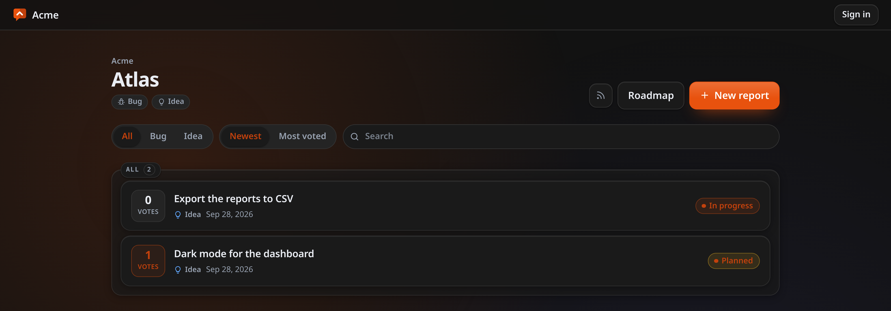

<div align="center">
  <br />
  
  <br /><br />

  <h1>LastHelp</h1>
  <p><strong>The front door your forge does not have.</strong></p>

  <p>
    <a href="https://codigosh.com/docs/lasthelp/">
      
    </a>
    &nbsp;
    
    &nbsp;
    
  </p>

  <br />

  

  <br /><br />

</div>

---

<div align="center">


</div>

---

📖 **[Read the Official Documentation](https://codigosh.com/docs/lasthelp/)** for detailed guides on installation, your first repository, connecting a forge, notifications and keeping the queue readable.

---

## Why LastHelp

Self-hosting your forge usually means turning registration off, and that closes the only door outsiders had for telling you something is broken. Opening registration to the world is not the answer; a separate front door is. The open-source feedback tools do not talk to any forge, and the ones that do are closed, paid and hosted by somebody else — so nobody serves the person who self-hosts their own forge, which is almost always the same person who would self-host a feedback portal. LastHelp was built with a simple rule: **anybody can tell you something without an account, and nothing reaches a public page until a person says so.**

It is **one static Go binary** and **one SQLite file**. No database server, no runtime, no external service, and no account for the people reporting. The first run is a three-step wizard in the browser.

| | |
| :--- | :--- |
| **Shape** | Single static binary (`linux/amd64`, `linux/arm64`) or Docker image |
| **Storage** | One SQLite file — a backup is a copy of it, or a button in the panel |
| **Setup** | A browser wizard. Zero configuration files |
| **Forges** | GitHub, GitLab, Gitea and Forgejo, including your own network |
| **Languages** | 20, hand-translated, with full RTL support |
| **Licence** | Apache-2.0 |
| **Telemetry** | None. Ever |

---

## Features

### For the people reporting

- **Reporting without an account** — a bug or an idea, in one form, from anybody. What they get back is a secret link: the only way to their own report, and the reason no sign-up is needed at all.
- **Bugs and ideas are two journeys** — a bug is asked which version and how to see it happen, and is not voted; an idea is one sentence, and gathers votes.
- **Screenshots with the report** — the person reporting attaches up to five pictures and the team replies with its own. Nothing is shown before the team has looked, the location and camera data in a photo are removed, and the pictures are erased thirty days after the report closes.
- **Similar reports while typing**, so the tenth person with the same crash adds a vote or a comment instead of a duplicate.
- **A roadmap nobody maintains** — three columns built from the state of each report, so it cannot be out of date.
- **Following without an address** — an Atom feed per repository that needs no account and stores nothing about whoever reads it, or an optional email when a mail relay is set up.

### For the team

- **One screen for everything that arrives** — **Reports**, in the top bar: every repository you work on in one list, the report beside it, and publish, reject and spam with a key each. It opens on what is waiting, and is also the archive of every report ever sent, with its filters in the address so a narrowed view can be sent to somebody else.
- **The whole report where you decide** — edit its words, change its status, reply, edit or delete any comment, fold a duplicate into the original, open or link a forge issue.
- **An overview worth opening** — the last thirty days as a chart you can ask about day by day, the most wanted ideas, the newest reports and the work per repository. Every number on it leads to the listing it counts.
- **Two levels of trust** — a **lead** runs an organisation, its forge token and its repositories; a **collaborator** triages the repositories they are given and never sees the token.
- **A front page you compose** — bands of modules for the repositories, the most voted ideas, what was resolved, statistics, links and your own words and images, arranged on a grid in the page itself.
- **Notifications for the team** through ntfy, Gotify, a webhook or mail, configured per repository.

### The forge bridge

- **GitHub, GitLab, Gitea and Forgejo**, hosted anywhere including your own network. A triaged report becomes an issue, or is attached to one that already exists — which is what a project with four thousand open issues actually needs.
- **The report follows the issue** — when it closes or reopens on the forge, the report and the roadmap follow.
- **Nothing calls your forge from inside a request**: work goes to a queue with backoff, so a forge having a bad afternoon delays an issue rather than losing a report.
- **No forge is a supported way to run** — everything except creating issues works without one.

### Keeping the queue readable

- **Nothing is published without a person.**
- **Anti-abuse without a third party** — a signed single-use form token, a timing window, a honeypot, rate limits keyed on the address a caller cannot choose, duplicate and link heuristics, an operator word list, and a breaker that closes a repository for a while rather than hand somebody a queue they will not open. Every refusal is counted by layer, because a filter nobody can measure is a filter quietly turning away people who never complain.

### Operations

- **A web updater** that verifies the signature and the checksum, makes the new binary prove it runs, refuses one older than the database, takes a backup and only then swaps — showing each step as it happens.
- **One-line install** on Linux with a hardened systemd unit, `--uninstall`, `--purge` and `--reinstall`, that tells you which version you have and stops when you already have the latest, and a backup before every upgrade.
- **Twenty languages**, translated by hand, with right-to-left laid out properly for Arabic, Persian and Urdu — applied on the server for the first paint.
- **Installable as an app** from the browser's own menu when served over HTTPS.
- **Reproducible builds** — `-trimpath`, `CGO_ENABLED=0` and a frontend stamped with a digest of its own output, so two builds of the same commit produce the same bytes.

---

## Status

**Stable.** Everything under Features works end to end, and each of it is checked by driving a real browser before it ships — on an empty installation and on one with months of history.

Not there yet, and said here rather than discovered:

- **Bitbucket** is not bridged.

---

## Security & Privacy

### Security

Passwords are hashed with Argon2id. Sessions are opaque tokens in an `HttpOnly`, `SameSite=Lax` cookie, marked `Secure` over HTTPS, and CSRF is a double-submit token checked alongside `Sec-Fetch-Site` — a header the browser writes from the real origins and a page cannot forge. Every response carries a Content-Security-Policy with `script-src 'self'`, so an injected script does not run, and `Referrer-Policy: no-referrer`, because the address of a report carries the token that opens it. Rate limits are keyed on the address our own proxy added rather than the first one the caller sent, because a proxy appends to `X-Forwarded-For` and reading the left-hand entry lets anybody choose their own identity. A stored forge token is never shown again and no endpoint returns one, request bodies are bounded per handler, and every release is signed.

For a detailed breakdown, including what the threat model does **not** cover, see the [Security Policy](SECURITY.md).

### Privacy

**Reporting is anonymous by design.** No account, no tracking, no analytics, and no telemetry of any kind: nothing about you or your instance is ever reported to us. The email address a reporter may leave is optional, asked for only when a mail relay exists to use it, never returned by any endpoint, and deleted when the report closes.

And no AI. Nothing anybody writes here is sent to a third party — the whole point is that it reaches one database and nowhere else.

---

## Installation Methods

### Quick Start with Docker

Images are built for `linux/amd64` and `linux/arm64` and published to our Forgejo registry with every release: `latest` moves with each stable release, `beta` with each prerelease.

**Using Docker Compose:**
```yaml
services:
  lasthelp:
    image: git.codigosh.com/codigosh/lasthelp:latest
    container_name: lasthelp
    restart: unless-stopped
    ports:
      - "8080:8080"
    volumes:
      - lasthelp-data:/data
    environment:
      # Turn this on only when a reverse proxy really is in front. With it on
      # and no proxy there, the caller chooses the address we attribute their
      # requests to, and the rate limits stop meaning anything.
      LASTHELP_TRUST_PROXY: "false"
    logging:
      driver: "json-file"
      options:
        max-size: "10m"
        max-file: "3"

volumes:
  lasthelp-data:
```

**Using Docker CLI:**
```bash
docker run -d \
  --name lasthelp \
  -p 8080:8080 \
  -v lasthelp-data:/data \
  --restart unless-stopped \
  git.codigosh.com/codigosh/lasthelp:latest
```

The image runs as an unprivileged user (uid 10001), so a named volume just works; a directory bound from the host has to belong to that user first (`chown 10001:10001 ./data`). The binary inside refuses to update itself, because updating a container is pulling a new image: `docker compose pull && docker compose up -d`.

Every setting the binary reads is listed in [.env.example](.env.example) and explained under [Settings](https://codigosh.com/docs/lasthelp/getting-started/install/#settings).

---

### Quick Install (Linux)

Run this command to install or update LastHelp:

```bash
curl -fsSL https://git.codigosh.com/CodigoSH/LastHelp/raw/branch/main/install.sh | sudo sh
```

It asks which port to use, which release channel to follow and whether a reverse proxy is in front, and remembers all three the next time you run it. The default channel is stable; answer `beta` to follow prereleases. Without a terminal to ask on — a container, a cron job — every answer is its default and `LASTHELP_CHANNEL=beta` supplies that one.

It verifies the signature over the checksums before anything reaches the disk, installs a systemd service, keeps the database in `/var/lib/lasthelp` and serves on port 8080 unless you answer otherwise when it asks. **The first account created is the administrator**: open the address it prints and claim the instance — a server with somebody in it cannot be claimed again.

---

## Updates

Updates are delivered directly from our own Forgejo instance — no proxy, no intermediary and no telemetry.

The updater checks the signature over the checksum list before it downloads anything, then the binary's own checksum, then makes the candidate prove it runs and report its schema, then refuses any binary older than the database, takes a backup, and only then replaces anything. None of those has a switch. In a container it says to pull an image instead of offering a button that would silently revert.

For detailed instructions see the [Updating guide](https://codigosh.com/docs/lasthelp/administration/updating/), or the [Security Policy](SECURITY.md) for how the signing works.

---

## Build

Requires [Go](https://go.dev) and [bun](https://bun.sh).

```sh
make build      # frontend + binaries into bin/
make run        # build and run
make test       # go test, the architecture rules and the frontend tests
make drive      # walk the whole journey in a real browser
make live-forge # and again against a real Forgejo, Gitea or GitLab in a container
make shots      # regenerate the images this repository shows
```

---

## Support & Recognition

We are an open-source initiative managed through [Open Collective Europe](https://opencollective.com/codigosh).

### Financial Support
If you find our tools useful, consider supporting our infrastructure through an unconditional donation.

[](https://opencollective.com/codigosh)

### Acknowledgments
Special thanks to everyone supporting our mission. 
<a href="https://opencollective.com/codigosh">
  
</a>

### Organizations
We appreciate the organizations that support us as a gesture of goodwill to help maintain our infrastructure.
<a href="https://opencollective.com/codigosh">
  
</a>

---

## Credits

- **Everything drawn here**: the mark, the icons and the charts are drawn by hand in this repository — no icon library, no chart library, no frontend framework. The whole frontend is TypeScript compiled by bun; its only dependencies are the type definitions and the TypeScript checker, both used while building and neither shipped.

Full attribution, including the Go modules compiled into the binaries, lives in [NOTICE](NOTICE).

---

A project by [CodigoSH](https://git.codigosh.com/CodigoSH) — built to last.
