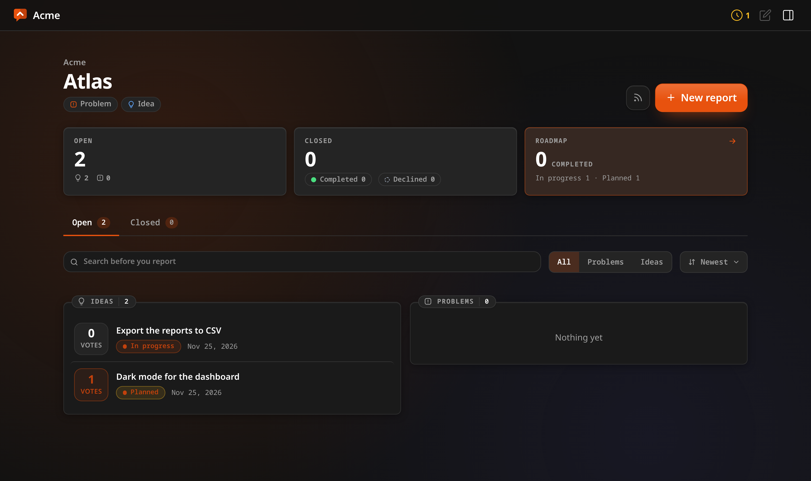

# LastHelp Documentation

A self-hosted feedback portal that speaks to your forge.

Anyone reports a problem or suggests an idea **without an account**. Ideas gather
votes. You triage what arrives and turn what deserves it into a real issue on
GitHub, GitLab, Gitea or Forgejo — including one on your own network. When that
issue closes, the report follows, which is what makes the roadmap something nobody
has to maintain.

One binary, one SQLite file, no external services.

- [Install](getting-started/install.md)
- [Your first project](getting-started/first-repository.md)
- [Connecting a forge](forges/connecting.md)
- [The overview](administration/overview.md)
- [Notifications](administration/notifications.md)
- [Signing in: two-step, passkeys and a proxy](administration/signing-in.md)
- [Passwords and locked accounts](administration/passwords.md)
- [Private organizations and boards](administration/private-boards.md)
- [Updating](administration/updating.md)
- [Keeping the queue readable](administration/anti-abuse.md)
- [Search engines](administration/search-engines.md)
- [What a visitor leaves behind](administration/privacy.md)

## What it does not do

- No tracking, no telemetry, no analytics.
- No AI. Nothing anybody writes here is sent to a third party.
- No paid tier. What exists is in the binary.
- No accounts for the public. Reporting is anonymous, and a secret link is what
  lets a reporter come back to their own report.
