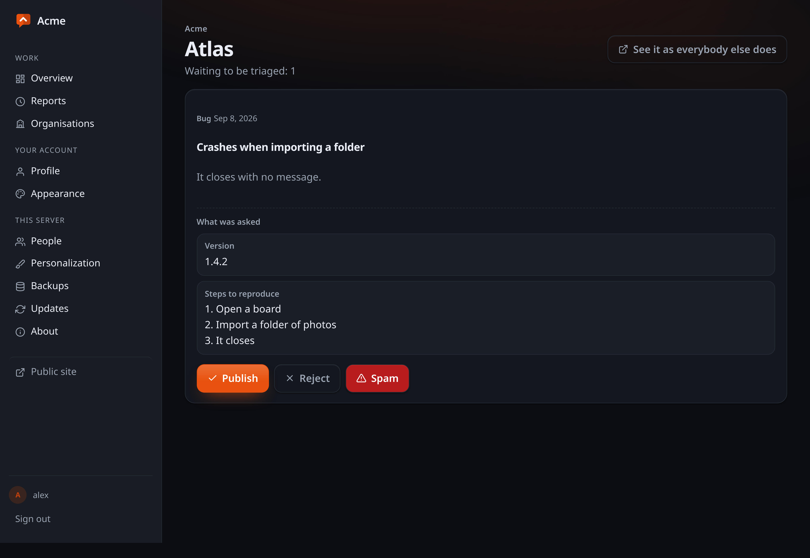

# Keeping the queue readable

What this protects is not the database. Nothing is published without approval,
so spam never reaches a public page. What it protects is **your attention**: the
failure it exists to prevent is a queue so full of rubbish that you stop opening
it.

Nothing here calls a third party. No captcha service, no reputation API, no
model — what people write in your portal reaches your database and nowhere else.

## The layers

1. **A signed, single-use form token.** Fetching the form is what separates
   somebody who opened the page from a script that found the endpoint, which is
   what most automated submission is. It turns "fetch the form once, submit for
   ever" into "fetch the form every time".
2. **A timing window.** A form filled in under two seconds was not typed; one
   submitted two hours later is a token somebody kept.
3. **A honeypot.** A field nobody can see. It answers as if it worked, because
   telling a script which check caught it is telling it what to change.
4. **Rate limits**, on the address *your* proxy appended and on its block — `/24`
   for IPv4 and `/64` for IPv6. A single IPv6 customer holds eighteen quintillion
   addresses, so limiting per exact address is limiting per attempt.
5. **Content heuristics**: the same text again (a flood is one paragraph over
   and over), too many links, and a word list you control — a word that means
   nothing on your repository is somebody else's daily traffic.
6. **A circuit breaker.** Past sixty submissions in an hour a repository stops taking
   them for a while. Refusing for an hour beats handing you a queue you will not
   open.
7. **The moderation queue**, which catches what the rest did not.

## Moderating less

A queue that holds everything is right on day one and a daily chore the day your
project gets popular. That is the real cost of not asking people for accounts,
and the lever is per repository: hold everything, or hold only the first thing from
each visitor.

## Knowing whether any of it works

Every refusal is counted by layer. Look at those numbers occasionally:

- A layer that never refuses anything is a layer to delete.
- A layer that refuses nearly everything is turning away people who did nothing
  wrong — and those people do not complain, they leave.

## What this does not stop

Somebody who has decided to target your project and is willing to work at it by
hand. Against that the tools are the breaker, closing submissions for a while,
and the fact that nothing is published without a person approving it.

Anyone claiming a spam filter stops a determined human is selling something.

## The queue

Two buttons and a third for spam. With four repositories you will see between zero and
five things a week, which is why there are no bulk actions, no saved views and
no search here: anything that assumes scale on this side is weight you carry for
a situation you do not have.

Comments wait in the same place, listed under the reports with the report each
one was written on. They are held for the same reason: the page tells whoever
writes one that a person will read it before it appears, and a portal where a
stranger can publish straight onto somebody else's report is a portal you would
have to watch. Your own replies are not held — you are the person.
