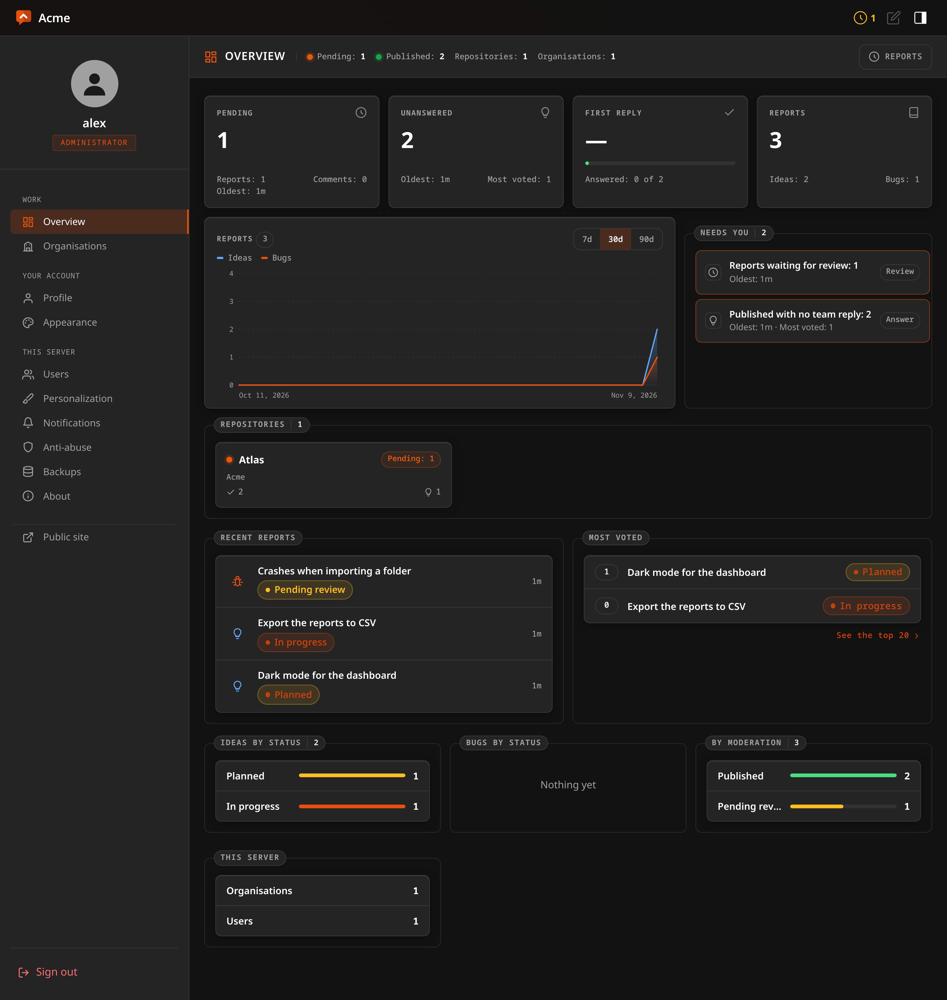

# The overview

The first page of the panel answers three questions in the order a team looking
after support asks them: what is waiting for me, who has not been answered, and
how is the work going.



It is the same page for everybody, over what they may see: the administrator
sees the whole server, anybody else sees the repositories they work on. Every
figure is counted by the server from the same conditions the listings use, so a
number and the list it opens cannot disagree.

## The four tiles

Press a tile to open the lines behind it. Escape closes it.

- **Pending** — reports and comments waiting for somebody to read them, which
  is the number on the Reports icon in the top bar, and how long the oldest has waited. The dialog
  lists both together, oldest first.
- **Unanswered** — reports that are published, not finished, and that nobody
  on the team has written on. A comment from a visitor is not an answer. The
  tile says how long the longest has gone without one and how many votes the
  most wanted of them has.
- **First reply** — how long the team took to write its first reply, as the
  middle value of the reports published in the last thirty days, counted from
  the moment each became visible: moderation is a wait of its own, and
  whoever reported does not feel it as the team being slow. It also says how
  many of those reports have a reply. With no reply in that window it shows a
  dash rather than a made-up time. The dialog breaks it down by repository.
- **Reports** — everything ever sent, split into ideas and bugs. The dialog
  shows what arrived in each repository over the last thirty days.

## Needs you

One list, most urgent first, and nothing in it that is zero:

- comments and reports waiting for review — late after two days;
- published reports with no team reply — late after seven days;
- confirmed bugs with no issue, on a repository whose organisation has a
  forge: work the team agreed was real that nobody has been given;
- deliveries the server gave up on after trying again — a notification or an
  issue that did not go out. Only the administrator is told, and it leads to
  the notification settings.

A late line is outlined in red and the rest in amber. Each line is a way into
the list it counted. With nothing to do it says so.

## The chart

Ideas and bugs, one line each on one scale, for a week, a month or three
months. Move the pointer over a day for what arrived on it: both kinds and the
total. Days are counted in UTC, so a report sent late in the evening west of
Greenwich counts towards the next day.

## Repositories and the rest

- **Repositories** — a tile for each, with what waits in it. Press it for its
  figures, the forge of its organisation and how many reports are linked to an
  issue, what its team is told through (the kind of channel, never its address
  or its token), and how far its ideas and its bugs have got.
- **Recent reports** and **Most voted** — the newest six, and the five most
  wanted ideas; the dialog of the second shows twenty.
- **Ideas by status** and **Bugs by status** — kept apart, because they do not
  share a vocabulary: *fixed* is not what an idea becomes and *planned* is not
  what a bug does. Each reads in the order the work moves.
- **By moderation** and **This server** — the latter, organisations and users,
  only for the administrator.

## Reports nobody answered

**Reports** has a **No team reply** switch, and the address `/review?reply=none`
opens it. It means what the tile means: published and not finished. Combined
with a repository, a kind or a search it narrows from there.

## Over the API

The panel reads three things; each needs a role anywhere and answers over the
repositories the account may triage.

```sh
# The overview. days is 7, 30 or 90 and defaults to 30; anything else is 30.
curl -b cookies.txt "$BASE/api/overview?days=7"

# One row per repository, with the same figures as the tiles.
curl -b cookies.txt "$BASE/api/overview/boards"

# Published and not finished, with no word from the team.
curl -b cookies.txt "$BASE/api/reports?reply=none"
```
