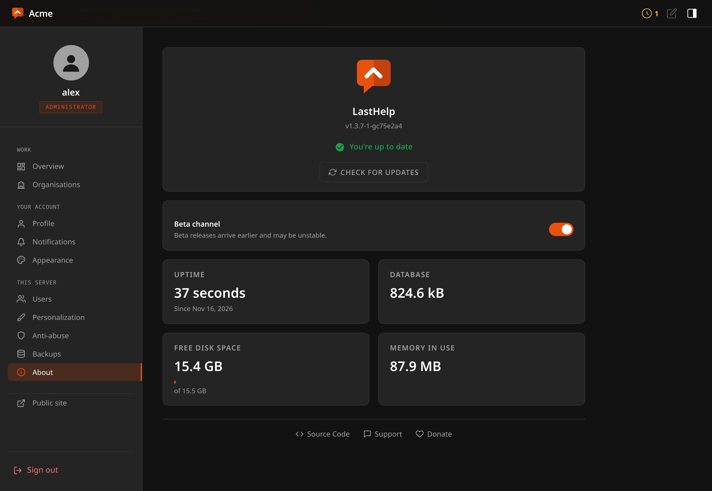

# Updating

Three ways, and the right one depends on how you installed.

## From the panel

Sign in as the administrator. When something newer is released, the panel
icon in the top bar carries a red dot and **About** in the sidebar says **New
update!**.

Rather than wait for the red dot, the server can tell you: turn on **New versions** under
**Notifications** (see [Notifications](notifications.md#telling-the-administrators-about-a-new-version))
and a push, a message or a mail arrives when something is out.

Open **About**. Under the version it says whether there is something newer — or
why it could not check — and when there is, **Update** opens a dialog with the
two versions, a link to what is new, and every step listed. Confirm it there and
each step turns green as it is done; the page reloads once the new version
answers. **Check for Updates** asks again.



The release channel is the switch just below. Following betas is remembered on
the server rather than in a browser, because a setting that forgets itself
between visits is one nobody trusts.

Beside the version, **Needs you** says **All in order** or lists what the server
has measured needs a hand, worst first, each with why it matters and the one
thing to do; **See all** opens the whole list. Only problems the server sees go
in it, never suggestions:

- **The disk is almost full** — with a quarter of it or less free it turns
  amber, with a tenth or less red. The database, and the copy taken before each
  update, need room.
- **Deliveries that failed** — what the server gave up on after trying again (a
  notification to the team, a mail to a reporter, an issue opened on the forge),
  with the last error.
- **A proxy is in front and was not declared** — see
  [`LASTHELP_TRUST_PROXY`](../getting-started/install.md#about-lasthelp_trust_proxy).
- **The public address is missing** — an organization is connected to a forge
  but `LASTHELP_PUBLIC_URL` is empty, so the issues it opens carry no link back
  to the report.
- **Reached without HTTPS** — somebody opened LastHelp over plain `http://`
  from another machine, so session cookies are not marked secure.
- **A new version is out**, with the way to the update.

**Server details**, a discreet button in the corner of the version card, shows
the machine (CPU, memory, disk, uptime), the installation (version, database
size and schema, LastHelp's own memory, platform) and the configuration: the
proxy in front and its hops, the public address, and whether outgoing mail,
outbound connections and HTTPS are on — never a password or a token. **Copy for
support** copies the lines a bug report needs (version, platform, schema, proxy
and HTTPS), with no addresses or names in them; where the browser offers no
clipboard, the text is shown selected, to copy by hand.

What it does, in this order, and each step either proves something or stops:

1. **Refuses outright if this build has no release keys.** No key does not mean
   accept anything.
2. Fetches the checksums, then their signature. **A missing signature aborts.**
   It never falls back to checksum-only: a host that could tamper with the
   binary could also delete the signature, and a fallback turns that into a way
   to strip the check rather than a failure.
3. Verifies the signature. Only a verified checksum file is allowed to say what
   the binary should hash to.
4. Downloads the binary, bounded.
5. Checks it against those checksums.
6. **Runs it.** It has to start on this machine and report what it is — which
   catches the wrong architecture, a truncated download, a missing library:
   every way a download can be intact and useless. Finding that out after the
   swap means finding out by being down.
7. **Refuses it if it understands an older schema than your database.** With a
   beta channel somebody eventually tries to install an older binary over a
   newer database, and the failure without this guard is not a crash — it is an
   old binary writing rows that ignore columns it does not know about.
8. **Backs up the database**, next to it, named after the release going in. The
   copy is a snapshot taken through the running database, not a copy of its
   file — which would be missing whatever was written since the last checkpoint
   and still look like a database — and it is opened and checked before it
   counts. The three newest copies are kept. If the copy cannot be taken, nothing
   is replaced.
9. Only now replaces the binary, keeping the one it replaces beside it as
   `lasthelp.old`, and restarts. The restart hands the listening port to the new
   process, so the port is never closed while it starts: a proxy in front sees
   requests answered, not refused.

Anything that fails leaves the running binary untouched and says which step it
was.

## With the installer

```sh
curl -fsSL https://git.codigosh.com/CodigoSH/LastHelp/raw/branch/main/install.sh | sudo sh
```

Run it again and it updates: it tells you which version you have, keeps the
port and settings it finds, backs up the database (stopping the service first,
and keeping the three newest copies), and does the same verification the panel
does — with `openssl` instead of Go.

When you already have the latest version it says so and stops, changing
nothing. Add `--reinstall` (`… | sudo sh -s -- --reinstall`) to install it
again anyway, to repair a damaged binary.

## From a container image (OCI)

Update the image. About says whether a newer one exists rather than offering a
button: replacing the binary inside a container lasts until the container is
recreated from its image and then silently reverts, which is worse than not
offering it. The same goes for any installation that cannot replace its own
program — LastHelp checks whether it may write where its binary is, so it does
not need to know what runs it.

With Docker Compose:

```sh
docker compose pull && docker compose up -d
```

With Podman, pull the image and recreate the container the same way you
created it.

On Proxmox VE, an OCI image runs as an LXC container. Proxmox has no step that
swaps the image of an existing container, so it is recreated from the new
image; the database survives only if `/data` is on its own mount point, which
is what the image declares. Tools that manage OCI applications on Proxmox, such
as ProxMenux, do this for you: they rebuild the container from the new image
and keep its data.

A binary copied into a directory its service cannot write to is in the same
position: download the new release from the releases page, or install with the
installer above, which gives the binary to the user the service runs as.

## If an update goes wrong

The backup is beside the database, named `lasthelp.db.before-<tag>`, and the
three newest are kept. To go back: stop the service, put the copy in place of
`lasthelp.db`, delete `lasthelp.db-wal` and `lasthelp.db-shm` if they are there
— they belong to the database you are replacing, and a database opened with
another one's journal is a damaged one — put `lasthelp.old` back as the binary
(or install the previous release), and start again.

The binary refuses to run against a database newer than it understands, so
downgrading without restoring the backup stops at startup with a message rather
than by corrupting anything.
