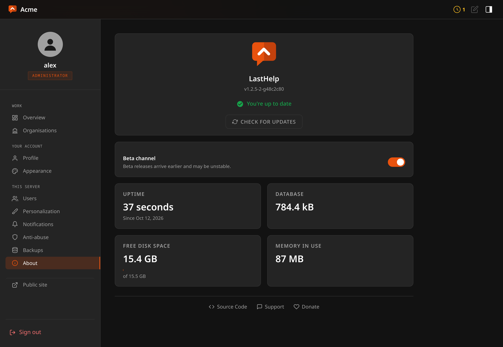

# Updating

Three ways, and the right one depends on how you installed.

## From the panel

Sign in as the administrator. When something newer is released, the panel
icon in the top bar carries a red dot and **Info** in the sidebar says **New
update!**.

Open **Info**. Under the version it says whether there is something newer — or
why it could not check — and when there is, **Update** opens a dialog with the
two versions, a link to what is new, and every step listed. Confirm it there and
each step turns green as it is done; the page reloads once the new version
answers. **Check for updates** asks again.



The release channel is the switch just below. Following betas is remembered on
the server rather than in a browser, because a setting that forgets itself
between visits is one nobody trusts.

What it does, in this order, and each step either proves something or stops:

1. **Refuses outright if this build has no release keys.** No key does not mean
   accept anything.
2. Fetches the checksums, then their signature. **A missing signature aborts.**
   It never falls back to checksum-only: a host that could tamper with the
   binary could also delete the signature, and a fallback turns that into a way
   to strip the check rather than a failure.
3. Verifies the signature. Only a verified checksum file is allowed to say what
   the binary should hash to.
4. Downloads the binary, bounded.
5. Checks it against those checksums.
6. **Runs it.** It has to start on this machine and report what it is — which
   catches the wrong architecture, a truncated download, a missing library:
   every way a download can be intact and useless. Finding that out after the
   swap means finding out by being down.
7. **Refuses it if it understands an older schema than your database.** With a
   beta channel somebody eventually tries to install an older binary over a
   newer database, and the failure without this guard is not a crash — it is an
   old binary writing rows that ignore columns it does not know about.
8. **Backs up the database**, next to it, named after the release going in.
9. Only now replaces the binary and restarts.

Anything that fails leaves the running binary untouched and says which step it
was.

## With the installer

```sh
curl -fsSL https://git.codigosh.com/CodigoSH/LastHelp/raw/branch/main/install.sh | sudo sh
```

Run it again and it updates: it keeps the port and settings it finds, backs up
the database, and does the same verification the panel does — with `openssl`
instead of Go.

## In a container

Pull a new image. Info says so, and whether a newer one exists, rather than
offering a button:
replacing the binary inside a container works until the next restart and then
silently reverts, which is worse than not offering it.

```sh
docker compose pull && docker compose up -d
```

## If an update goes wrong

The backup is beside the database, named `lasthelp.db.before-<tag>`. Stop the
service, put it back, install the previous release, start again.

The binary refuses to run against a database newer than it understands, so
downgrading without restoring the backup stops at startup with a message rather
than by corrupting anything.
