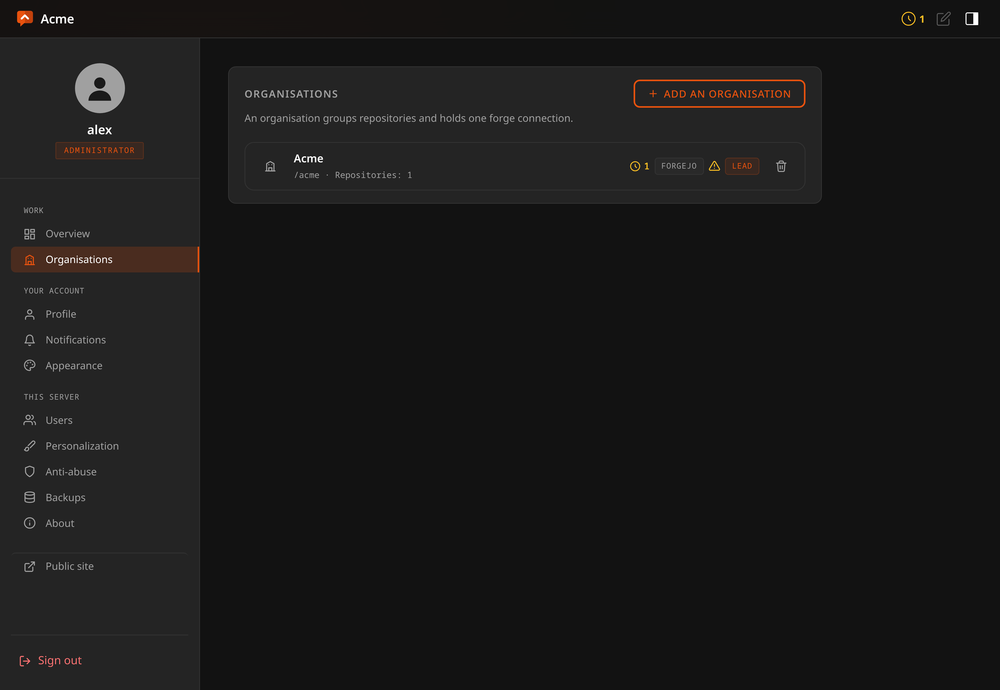
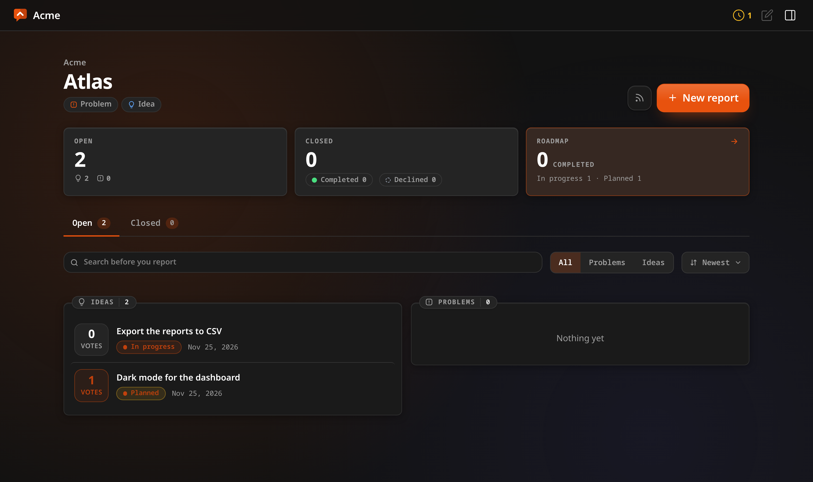
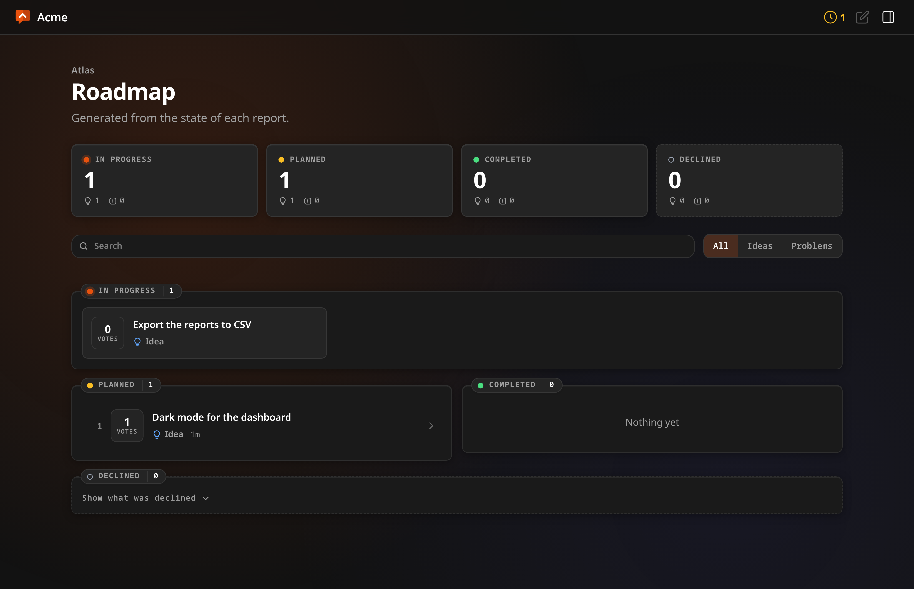

# Your first project

The structure is two levels, and they are the ones your forge already has:

- An **organization** is a connection to a forge: its address, the account
  that owns the repositories there, and the credentials. It is not an org chart — a token cannot span two
  organizations on any forge, so the boundary is imposed rather than invented.
- A **project** is one place people report about: its own public page, roadmap
  and feed. With a forge connected it points at one repository there, where its
  issues are opened.

A product spread over twenty repositories does not have to be twenty projects.
Most make one and send everything there, because somebody reporting "the video
stutters on my phone" does not know which of your twenty repositories that lives
in, and should not have to.

## Creating them

From the panel: **Organizations** in the sidebar, then **Add an organization** —
a name, an address, and which forge it connects to, or none. Open it and press
**Add a project**.



The dialog asks everything the project's settings do, so it is made the way it
will stay, in three steps:

1. **Project** — its icon, its name and its address, on one line. The address
   is part of every link and cannot be changed later.
2. **What it receives** — a use to start from, then the options under
   **Customize the options**:
   - **Software** — problems, with the version and the steps asked, and ideas
     with votes. The default.
   - **Community** — problems and ideas, with no technical questions.
   - **Ideas only** — suggestions and votes, no problems.
   - **Custom** — each option chosen by hand.

   The options are in two groups. **Reports**: *Problems*, with *Ask for the
   version* and *Ask for the steps* under it; *Ideas and suggestions*, with
   *Votes on ideas* under it; and *Images*. **Visibility and notices**: *Team
   only*, *Public roadmap*, the repository on the forge when the organization
   has one, and *Team notices* when the server has a notification channel —
   the server's channel, or none. A use only sets the reports; who may see the
   project is a separate choice. Each option has an **i** beside it that says
   what it does.
3. **How it will be** — what the project will have and will not have, who can
   see it, and whether the team is told. A project must receive problems,
   ideas or both: the summary says so before the server refuses.

The project's **Settings** card shows the same groups, open, so anything chosen
here can be changed there.

Both an organization and a project can carry an **icon**: a project's is shown
on the front page, on its organization's page and at the head of its own page,
and an organization's beside its name. Without one, a project shows its
initials.

The first run does not ask for either of them. It configures the installation —
language, the administrator account, and what this installation calls itself —
and stops there. Organizations and projects are the work, made and unmade
for years after that screen is gone.

Or over the API, which is what the panel calls:

```sh
# The address of your instance, and a session from signing in.
BASE=http://localhost:8080

curl -X POST "$BASE/api/organizations" \
  -H 'Content-Type: application/json' \
  -H "X-CSRF-Token: $CSRF" -H 'Sec-Fetch-Site: same-origin' \
  -b cookies.txt -c cookies.txt \
  -d '{"slug":"acme","name":"Acme","forge":"forgejo",
       "base_url":"https://git.example.com","forge_owner":"acme"}'

curl -X POST "$BASE/api/orgs/acme/repositories" \
  -H 'Content-Type: application/json' \
  -H "X-CSRF-Token: $CSRF" -H 'Sec-Fetch-Site: same-origin' \
  -b cookies.txt -c cookies.txt \
  -d '{"slug":"atlas","name":"Atlas","accepts_bugs":true,"accepts_ideas":true,
       "asks_version":true,"asks_steps":true,"votes":true,"roadmap_public":true}'
```

Every choice has a field: `accepts_bugs`, `accepts_ideas`, `accepts_images`,
`asks_version`, `asks_steps`, `votes`, `roadmap_public` and `private`, with
`channel` set to `none` for a project that starts with no notifications. Left
out, images, votes and the public roadmap are on, and the two questions and
`private` are off.

The project is then at `/acme/atlas`, its roadmap at
`/acme/atlas/roadmap`, and its feed at
`/feed/acme/atlas/atom.xml`.

`forge` may be `github`, `gitlab`, `gitea`, `forgejo` or `none`. **`none` is a
supported way to run**, not a placeholder: everything except turning a report into
an issue works without a forge, and the screens say there is none rather than
offering buttons that fail.



## Problems and ideas are two different journeys

They are asked different things and treated differently, on purpose:

- **A problem can be asked which version and how to see it happen.** Two
  optional boxes, each a switch in the project's settings: they suit software,
  and a project about something else leaves them off. Where they are asked, they
  are the difference between a report somebody can pick up and one they have to
  go and ask about.
- **An idea is asked neither.** An idea is the sentence somebody wrote, and
  every extra box on a public form is somebody deciding not to bother.
- **A problem is not voted.** Two hundred people agreeing that something crashes
  does not make it crash harder; what it needs is somebody able to reproduce it.
  Its statuses are *new, confirmed, in progress, fixed, declined*.
- **An idea is voted, and its value is not reaching your issue tracker yet.**
  That is what stops the tracker turning into a wishlist with a thousand open
  entries. Its statuses are *new, planned, in progress, completed, declined*. A
  project can turn **Votes on ideas** off: the button and the count disappear,
  and the server refuses a vote.

Both land on the same roadmap lanes, because to somebody reading it a confirmed
problem and a planned idea are the same news, and an idea and a problem the team
turns down are both *declined*.

## The project's own questions

Under **Questions on the form**, in a project's settings, the team adds up to
**ten** questions of its own beside the title and the description: a line of
text, a paragraph, a choice from a list or a date. Each is asked of problems, of
ideas or of both, and each is required or not. They can be edited, moved and
removed there.

The server checks every answer — a required one answered, a choice from the
list, a date that is a date — and keeps it with the wording the question had
when it was answered, so rewording or removing a question never changes a
report already sent.

The answers, like the version and the steps, travel with the report: onto its
public page, into the export, and into the forge issue under the description.

## Who can do what

| Level | Role | Can |
|---|---|---|
| Server | **Administrator** | Everything, and the only one who crosses organizations |
| Organization | **Lead** | Its connection and **its token**, its projects — including deleting them —, who works in it, and deleting reports. Ending the organization itself is the administrator's |
| Project | **Collaborator** | Triage that project: moderate, edit, change status, reply, edit and delete comments and replies, create and link issues. **Never sees the token** |

Accounts are created by the administrator, under **Users**. Who works where is
given where the work is, in the **Team** card: on the organization's page,
**Add to team** opens a dialog to make somebody a lead or a collaborator on one
of its projects, and the pencil on a member changes what they are; on a
project's page, **Add collaborator** does the same for that project. The
administrator and any lead of that organization can do both. Each member's role
is shown beside their name.

That last line of the table is the reason the two levels exist. Somebody trusted to triage
one project is not automatically somebody trusted with a credential that can
write to every repository the organization owns.

## Votes are a signal, not a ballot

A voter is a random identity in a signed cookie, never an address — behind a
household router or a mobile carrier the address is shared, so keying votes on
it would let one neighbor spend everybody else's vote and make a whole office
count as one person.

The honest consequence: clearing the cookie allows a second vote. That is a
documented limit rather than a defect. The alternative is asking people to
create an account, which is the thing this product exists not to do, so treat a
vote count as a signal of what is popular rather than as a count of people.

**An answered idea stops taking votes.** When you mark an idea done, declined or
closed, its page keeps the number and loses the button, and a vote can no longer
be given or taken back, so the count is what people wanted when you answered.
Reopen the idea and voting opens with it.

**An answered report stops taking comments, after a grace of 48 hours.** For
visitors it is the same moment votes stop, for an idea and for a problem: the thread
stays on the page, the comment form is replaced by a line saying it is closed,
and a comment sent from a page opened earlier is refused. The person who
reported it, holding their follow link, and you keep the form for 48 hours after
the answer, with a line saying until when: an answer is rarely the end of the
exchange, and the reporter is the one who can say whether the fix worked. After
that the conversation closes for everybody. Answering again starts the 48 hours
again; reopening the report opens the conversation at once. Pictures follow the
same rule as the message they go on. You can still edit or delete what is
already there.

**What you close stays where people can read it.** A declined idea or a problem you
could not reproduce moves to the board's **Closed** view with its votes and its
thread, and the status says what you decided: a completed one is solid and green,
a declined one has a dashed edge and a hollow dot. The Closed view has two lanes,
**Completed** and **Declined**, each with its count. **Open** and **Closed** are
two tabs above the search box, each with how many it holds. Beside the search box
**All**, **Problems** and **Ideas** choose the type in one press, once you are
looking at Closed the **Filters** button offers **Completed** or **Declined**, and the last button orders
it by newest or by votes. What is chosen shows underneath as chips that come off
with one press, and the choice is in the address, so it can be sent. The tiles
above only say the numbers; the one for the roadmap is the way to its page, and
it says how much was completed, because that is the work somebody new wants to
see. It is also what somebody
sees when they start typing the same thing: the similar reports under the title
include closed ones with that status, and the line beside them says a closed
report takes no more votes, so they read what was decided before asking again.

Votes are there to point you at what people want, not to decide it. Anybody can
vote again by changing browser, clearing cookies or changing address, and that
is accepted: the voter cookie lasts a year, and past that the number is still
only a guide.

## Pictures

A screenshot is often the quickest way to show a problem, so a report can carry
pictures.

- **Who adds them.** The person reporting, on the form — up to **five** — and on
  their own follow-ups, up to **three** each, with their secret link. Your team,
  on its replies, up to three each. A visitor's comment carries words only.
- **What happens to them.** The browser makes each one smaller before it is sent.
  The server then draws it again from its pixels, at most 1600 pixels on its
  longest side plus a small copy for the report page. Anything else the file
  carried is not kept: the place a phone photo was taken, the camera, anything
  hidden after the image.
- **Who sees them.** A picture waits with what it belongs to. Until you approve
  the report, or the follow-up, only your team and the reporter see it, even
  with its address. That is the moment to look at each one: you can **take out a
  single picture** and approve the rest, because a report can be right while one
  screenshot shows something it should not.
- **Taking one back.** The reporter can remove their own from their report's
  page. Your team can remove any.
- **When they go.** Thirty days after a report is closed, so reopening it in that
  time loses nothing. At once when a report or a message is rejected, marked as
  spam or deleted. When you fold a duplicate into another report, the pictures on
  the duplicate move to the one that stays.
- **Limits.** Twenty pictures per report, counting every message on it, and
  2 MB per picture as it arrives. The whole installation keeps at most 512 MB of
  pictures. When that is full, new ones are refused with a message that says so.

Each project has a switch for this in its settings, **Images**, on by default.
Turn it off and the forms stop offering pictures.

Pictures live in the database, so a backup includes them. A project's JSON
export, below, does not.

## Taking your data with you

Every project exports as JSON, from its page in the panel or at
`/api/orgs/<org>/repos/<project>/export`. It carries everything the operator
decided — the published items, the queue, the rejections, the merged duplicates,
the comments and the issue links — because an export that showed only the
approved half would misrepresent the record.

It deliberately carries **no reporter email addresses and no follow tokens**.
Taking your data with you must not mean taking everybody's: those addresses are
personal data collected for one purpose, and a follow token is a credential.

## The roadmap

The roadmap page is **in progress**, **planned**, **completed** and **declined**,
and all four are always drawn — showing only the ones with something in them
leaves a reader working out which they are looking at. A confirmed problem and a
planned idea share *planned*, and a fixed problem and a shipped idea share
*completed*.

- Four tiles at the top count the lanes, with how many ideas and how many problems.
  They only say the numbers: on a phone the lanes follow one another.
- A search box and **All**, **Ideas** and **Problems**, in one press, narrow every lane at once, and the dialog a lane opens starts from the same words and filter.
- *Planned* is ranked by votes and shows the first six; *completed* is grouped by
  the month each thing was completed in and shows the newest six, within the
  latest two months; what is in progress shows six cards. Each lane that has more has a **Show
  more** button, which opens the lane whole in a dialog, with a search over every item in it,
  the same **All** / **Ideas** / **Problems** choice, an order menu (most voted, or newest), a page at
  a time. The page itself stays a screen or two long however many reports
  there are.
- **Declined** is shut until somebody asks for it: the page is about what is going
  to happen. What was declined is public already, on the board under *Closed*, and
  the reply on each report is where the team says why.

The page loads the first hundred of each lane; the dialog reads the rest from the
server. The front page's roadmap module shows the first three of each.

A project can keep its roadmap to the team: with **Public roadmap** off, its
roadmap page and the tile that leads to it are the team's alone, it is left out
of the front page's roadmap and of the sitemap, and anybody else who opens its
address finds nothing there. The board itself stays public.


