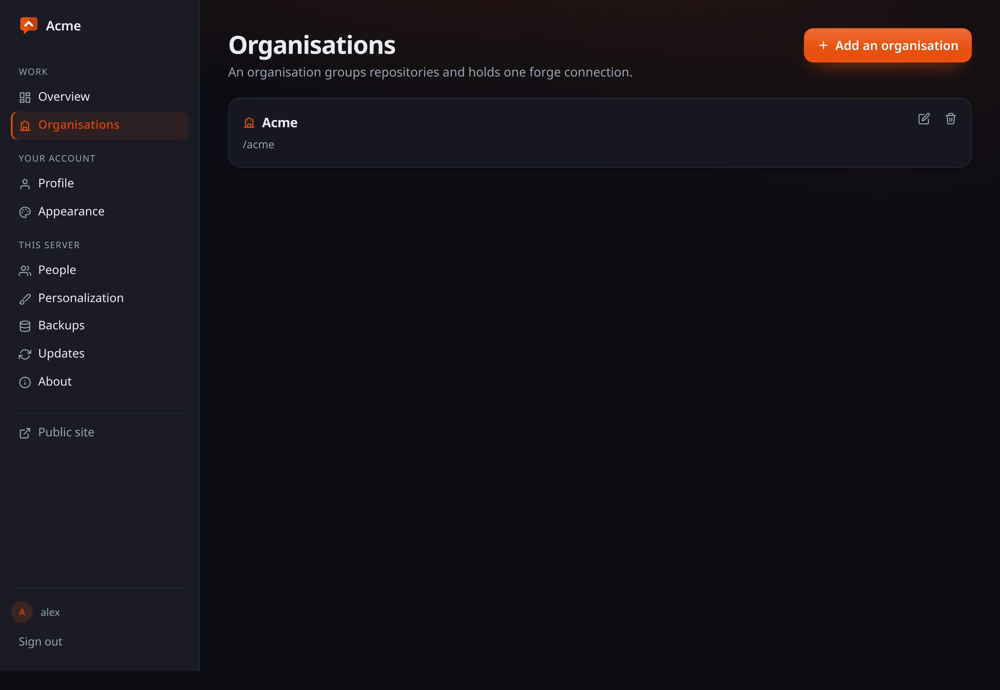
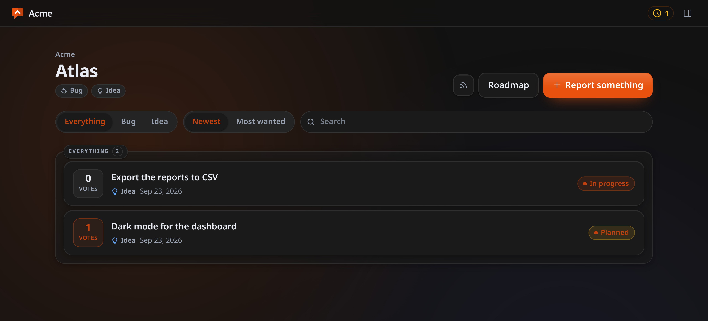
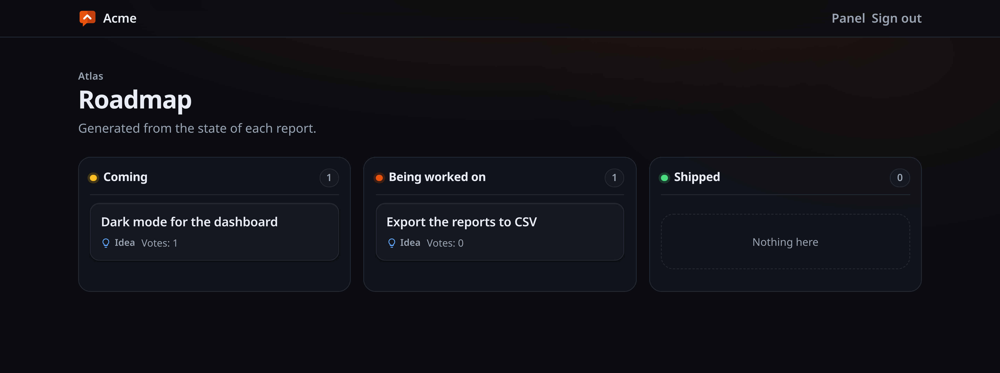

# Your first repository

The structure is two levels, and they are the ones your forge already has:

- An **organisation** is a connection to a forge: its address, the account
  that owns the repositories there, and the credentials. It is not an org chart — a token cannot span two
  organisations on any forge, so the boundary is imposed rather than invented.
- A **repository** is one place people report about. You register only the
  ones you want feedback for.

A project spread over twenty repositories does not have to register twenty. Most
register one and send everything there, because somebody reporting "the video
stutters on my phone" does not know which of your twenty repositories that lives
in, and should not have to.

## Creating them

From the panel: **Organisations** in the sidebar, then **Add an organisation** —
a name, an address, and which forge it connects to, or none. Open it and add a
repository the same way.

Both can carry an **icon**, chosen in their settings: a repository's is shown on
the front page and on its organisation's page, and an organisation's beside its
name on its own page. Without one, a repository shows its initials.



The first run does not ask for either of them. It configures the installation —
language, the administrator account, and what this installation calls itself —
and stops there. Organisations and repositories are the work, made and unmade
for years after that screen is gone.

Or over the API, which is what the panel calls:

```sh
# The address of your instance, and a session from signing in.
BASE=http://localhost:8080

curl -X POST "$BASE/api/organizations" \
  -H 'Content-Type: application/json' \
  -H "X-CSRF-Token: $CSRF" -H 'Sec-Fetch-Site: same-origin' \
  -b cookies.txt -c cookies.txt \
  -d '{"slug":"acme","name":"Acme","forge":"forgejo",
       "base_url":"https://git.example.com","forge_owner":"acme"}'

curl -X POST "$BASE/api/orgs/acme/repositories" \
  -H 'Content-Type: application/json' \
  -H "X-CSRF-Token: $CSRF" -H 'Sec-Fetch-Site: same-origin' \
  -b cookies.txt -c cookies.txt \
  -d '{"slug":"atlas","name":"Atlas","accepts_bugs":true,"accepts_ideas":true}'
```

The repository is then at `/acme/atlas`, its roadmap at
`/acme/atlas/roadmap`, and its feed at
`/feed/acme/atlas/atom.xml`.

`forge` may be `github`, `gitlab`, `gitea`, `forgejo` or `none`. **`none` is a
supported way to run**, not a placeholder: everything except turning an item into
an issue works without a forge, and the screens say there is none rather than
offering buttons that fail.



## Bugs and ideas are two different journeys

They are asked different things and treated differently, on purpose:

- **A bug is asked which version and how to see it happen.** Two optional
  boxes, and they are the difference between a report somebody can pick up and
  one they have to go and ask about. They travel with it: onto the public page,
  into the export, and into the forge issue under the description.
- **An idea is asked neither.** An idea is the sentence somebody wrote, and
  every extra box on a public form is somebody deciding not to bother.
- **A bug is not voted.** Two hundred people agreeing that something crashes
  does not make it crash harder; what it needs is somebody able to reproduce it.
  Its statuses are *new, confirmed, fix in progress, fixed, can't reproduce*.
- **An idea is voted, and its value is not reaching your issue tracker yet.**
  That is what stops the tracker turning into a wishlist with a thousand open
  entries. Its statuses are *new, planned, in progress, shipped, not planned*.

Both land on the same three roadmap columns, because to somebody reading it a
confirmed bug and a planned idea are the same news.

## Who can do what

| Level | Role | Can |
|---|---|---|
| Server | **Administrator** | Everything, and the only one who crosses organisations |
| Organisation | **Lead** | Its connection and **its token**, its repositories — including deleting them —, who works in it, and deleting reports. Ending the organisation itself is the administrator's |
| Repository | **Collaborator** | Triage that repository: moderate, edit, change status, reply, edit and delete comments and replies, create and link issues. **Never sees the token** |

Accounts are created by the administrator, under **Users**. Who works where is
given where the work is: leads on the organisation's page, collaborators on
each repository's page — by the administrator or by any lead of that
organisation.

That last line of the table is the reason the two levels exist. Somebody trusted to triage
one repository is not automatically somebody trusted with a credential that can
write to every repository the organisation owns.

## Votes are a signal, not a ballot

A voter is a random identity in a signed cookie, never an address — behind a
household router or a mobile carrier the address is shared, so keying votes on
it would let one neighbour spend everybody else's vote and make a whole office
count as one person.

The honest consequence: clearing the cookie allows a second vote. That is a
documented limit rather than a defect. The alternative is asking people to
create an account, which is the thing this product exists not to do, so treat a
vote count as a signal of what is popular rather than as a count of people.

**An answered idea stops taking votes.** When you mark an idea done, declined or
closed, its page keeps the number and loses the button, and a vote can no longer
be given or taken back, so the count is what people wanted when you answered.
Reopen the idea and voting opens with it.

Votes are there to point you at what people want, not to decide it. Anybody can
vote again by changing browser, clearing cookies or changing address, and that
is accepted: the voter cookie lasts a year, and past that the number is still
only a guide.

## Taking your data with you

Every repository exports as JSON, from its page in the panel or at
`/api/orgs/<org>/repos/<repository>/export`. It carries everything the operator
decided — the published items, the queue, the rejections, the merged duplicates,
the comments and the issue links — because an export that showed only the
approved half would misrepresent the record.

It deliberately carries **no reporter email addresses and no follow tokens**.
Taking your data with you must not mean taking everybody's: those addresses are
personal data collected for one purpose, and a follow token is a credential.

## The roadmap

Both journeys land on the same three columns, and all three are always drawn —
showing only the ones with something in them leaves a reader working out which
two of three they are looking at.


