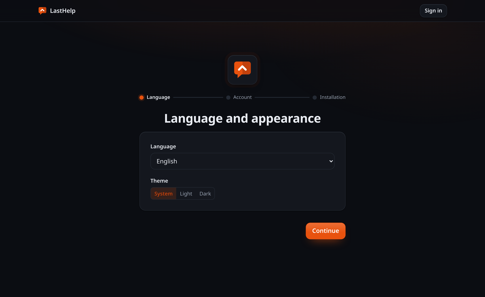

# Install

## One command

```sh
curl -fsSL https://git.codigosh.com/CodigoSH/LastHelp/raw/branch/main/install.sh | sudo sh
```

It downloads a release, **checks that it is ours before installing anything**,
and sets up a hardened systemd service. Read it first if you would rather — it
is one file, and piping a script into a root shell is a thing to do knowingly.

What it refuses rather than warns about:

- A checksum file whose signature does not match a key it knows.
- A binary that does not match the signed checksums.
- Not having `openssl`, because an unverified binary is not worth the
  convenience of installing without it.
- Having an `openssl` older than **3.0**. Verifying an ed25519 signature from
  the command line needs `pkeyutl -rawin`, which 1.1.1 does not have — and
  there is no other way to do it there, so the script says so plainly instead
  of failing with a message about an unknown option. Anything from Ubuntu
  22.04, Debian 12 or RHEL 9 onwards is new enough.

Run it again to update. It stops the service, **backs up the database first**,
replaces the binary and starts again — and it keeps the port and the
configuration it finds rather than asking twice. The one file it never
overwrites is `/etc/lasthelp/lasthelp.env`, because that is the one you have
edited by hand.

It answers `--help`, and it can undo itself:

```sh
sudo sh install.sh --uninstall           # removes it, keeps the reports
sudo sh install.sh --uninstall --purge   # erases them too, after you type DELETE
```

`LASTHELP_CHANNEL=beta` installs the latest beta instead of the latest stable.
Every path it writes to can be pointed elsewhere the same way —
`LASTHELP_PREFIX`, `LASTHELP_DATA`, `LASTHELP_ETC`, `LASTHELP_UNIT` — which is
how it gets tested against a throwaway tree.

## What it installs, and where

| | |
|---|---|
| `/opt/lasthelp/bin/lasthelp` | the binary, owned by the service account so it can update itself |
| `/var/lib/lasthelp/` | the database and the key that decrypts forge tokens |
| `/etc/lasthelp/lasthelp.env` | the configuration, yours to edit |
| `/etc/systemd/system/lasthelp.service` | the unit, taken from the release and covered by its signature |

The unit is not written by the installer: it ships **with the release** and is
listed in the signed `SHA256SUMS` alongside the binary, so the sandbox it puts
the service in is verified rather than being whatever the copy of the installer
you happened to run had inside it.

## With Docker

```sh
docker run -d --name lasthelp \
  -p 8080:8080 \
  -v lasthelp-data:/data \
  lasthelp:latest
```

Or with the compose file in the repository:

```sh
docker compose up -d
```

Open `http://localhost:8080`. An unclaimed instance opens on the setup wizard
rather than hiding it behind a sign-in link: three steps — the language and the
look, the administrator account, and what this installation calls itself.



The first account created is the administrator, and setup then refuses to run
again. Anybody who finds an unclaimed instance before you do becomes its
administrator, so claim it before you put it on the internet.

It asks for a **username**, not an email address. Nothing is ever sent to it,
and the second password box is the one thing standing between a typo and an
installation nobody can sign into — there is no reset here.

## From source

Requires Go and [bun](https://bun.sh).

```sh
make build   # frontend and binaries into bin/
./bin/lasthelp
```

## Where the data lives

Two files, and they are not the same thing:

| File | What it is |
|---|---|
| `lasthelp.db` | Everything: repositories, reports, votes, accounts |
| `lasthelp.key` | The key that encrypts the forge tokens and reporters' email addresses |

**Back up both, but not into the same place.** The key sits beside the database
rather than inside it precisely so that a leaked database backup is a leak of
hashes and public text rather than of write access to your forge. Copying them
together undoes that.

Lose the key and the encrypted values are gone: you would re-enter the forge
tokens, and any stored email addresses become unreadable. Nothing else is
affected.

## Settings

Every environment variable this binary reads is listed in `.env.example`, and an
architecture test fails the build if one is missing from it or if that file
invents one the binary does not read. The ones worth knowing about:

| Variable | Default | What it does |
|---|---|---|
| `LASTHELP_PORT` | `8080` | Listening port. `LASTHELP_ADDR` takes a full address instead |
| `LASTHELP_DB_FILE` | `lasthelp.db` | The database |
| `LASTHELP_KEY_FILE` | beside the database | The encryption key |
| `LASTHELP_PUBLIC_URL` | empty | Where this instance is reachable, for the links in notifications and feeds |
| `LASTHELP_TRUST_PROXY` | `false` | Turn on **only** when a reverse proxy really is in front |
| `LASTHELP_TRUST_PROXY_HOPS` | `1` | How many proxies |
| `LASTHELP_OFFLINE` | `false` | Stops every outbound connection |

### About `LASTHELP_TRUST_PROXY`

With it on and no proxy actually in front, a caller can put whatever they like in
`X-Forwarded-For` and choose the address their requests are attributed to — which
means the rate limits stop meaning anything. LastHelp reads the entry *your*
proxy appended, not the leftmost one, so it is safe when the setting is true and
a proxy is really there, and only then.

### About `LASTHELP_OFFLINE`

It stops the forge calls and the notifications. It exists so the claim that this
server only talks to what you configured is something you can check rather than
take on trust: turn it on, and if anything still reaches the network, the
documentation is wrong.
